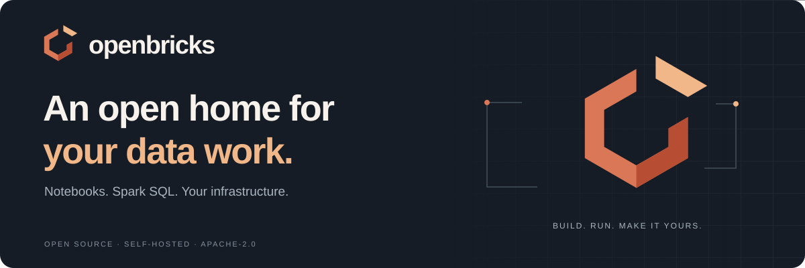
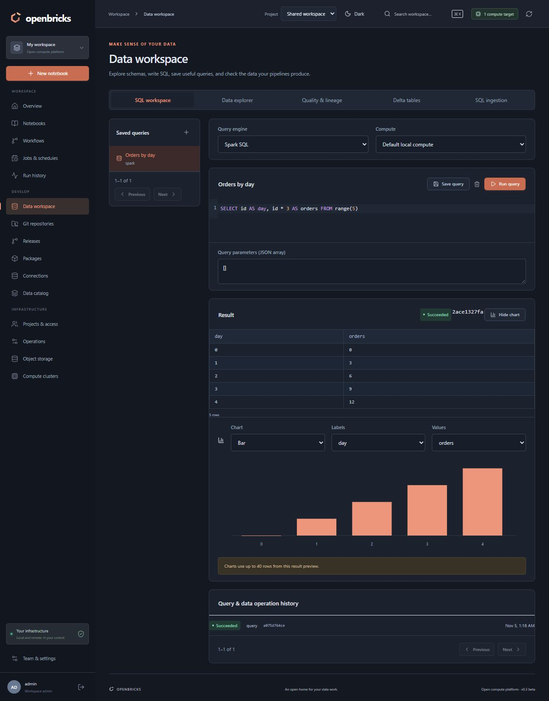

# OpenBricks

**An open home for your data work.**

**Version: 0.5.0.** Build from source with the quickstart below, or use the pinned Docker images and deployment bundle from a [published release](https://github.com/DylanBarber/OpenBricks/releases). See [container installation and releases](docs/RELEASING.md).

Prebuilt images are available on Docker Hub for [management](https://hub.docker.com/r/darbs5342/openbricks) and [compute](https://hub.docker.com/r/darbs5342/openbricks-compute). Follow the [versioned image installation guide](DEPLOYMENT.md#versioned-images-and-upgrades) to use them with `compose.release.yaml`. GHCR images remain supported.

The [whole-system test guide](docs/STABLE_TESTING.md) reproduces the release checks with a real disposable SQL Server, separate compute workers, local S3 storage, Unity Catalog, and encrypted recovery onto fresh volumes.

A self-hosted notebook workspace for Python, Spark SQL, and scheduled data pipelines. OpenBricks brings notebooks, Git imports, reusable Python packages, object storage, and compute management into one browser UI.

Start with two Docker containers on one computer. Add trusted remote compute hosts when you need more room. Keep your files on your own infrastructure, with no cloud account required.

[Quick start](#quick-start) · [Git walkthrough](#from-git-to-a-scheduled-pipeline) · [Examples](#example-projects) · [Deployment](DEPLOYMENT.md) · [Contributing](CONTRIBUTING.md)

Explore the guide

- [Meet the workspace](#meet-the-workspace)
- [Your first notebook](#your-first-notebook)
- [Editor, parameters, and revisions](#editor-parameters-and-revisions)
- [Workflows, releases, and reruns](#workflows-releases-and-reruns)
- [From Git to a scheduled pipeline](#from-git-to-a-scheduled-pipeline)
- [Example projects](#example-projects)
- [Reusable Python packages](#reusable-python-packages)
- [Scheduling and run history](#scheduling-and-run-history)
- [SQL Server and object storage](#connect-your-data)
- [Optional Unity Catalog](#optional-unity-catalog-oss)
- [Architecture and remote compute](#architecture-and-remote-compute)
- [Memory and sessions](#memory-and-session-behavior)
- [Persistence, backups, and portability](#persistence-backups-and-portability)
- [Operations and notifications](#operations-and-notifications)
- [Projects and access](docs/PROJECTS.md)
- [Trust model and boundaries](#trust-model-and-current-boundaries)
- [Development](#development)
- [FAQ](#faq)
- [Contributing and brand assets](#contribute-and-make-it-yours)

## Why OpenBricks?

The name is a nod to familiar notebook workflows and the open building blocks underneath them. OpenBricks is for small, trusted teams who want to explore data, share Python code, and run repeatable jobs on infrastructure they control.

- **A complete workspace:** organize notebooks in folders, mix Python and SQL, inspect results, and trace scheduled runs.
- **Real Spark:** run Apache Spark locally in a dedicated compute container, or connect an OpenBricks compute service to an existing Spark standalone deployment.
- **Portable by design:** container images carry the runtime; persistent volumes carry your workspace and data.
- **Open components:** Apache Spark, SeaweedFS, and optional Unity Catalog OSS, with an Apache-2.0-licensed application.

OpenBricks is an independent project inspired by Databricks. It is not affiliated with Databricks or a complete implementation of its platform, APIs, or security model.

## Meet the workspace

The screenshot shows a real Spark SQL result and chart from a disposable workspace. Also see the [starter notebook's SQL report](docs/assets/workspace-dark.png) and [imported notebook folders](docs/assets/workspace-folders-dark.png).

| Capability | What you can do |
| --- | --- |
| Notebooks and editor | Mix Python, Spark SQL, and Markdown; use highlighting, completion suggestions, formatting, tabs, notebook-wide find/replace, and source revisions |
| Parameters | Define typed defaults/required inputs, override them for manual or scheduled runs, and use a limited widgets compatibility helper |
| Workspace folders | Create nested directories, follow breadcrumbs, search, rename, and move notebooks or folders |
| Git and releases | Clone/import, edit files, branch, diff, export notebooks, commit/push, create pull requests, and capture exact committed sources |
| Python packages | Build/upload wheels, capture content-addressed package environments, and synchronize required artifacts to compute |
| Workflows | Connect notebooks in a dependency graph with per-step compute/timeouts, explicit safe retries, and captured-source repair/rerun |
| Scheduling | Basic or cron schedules with timezones, missed-run recovery, date backfills, and file/Delta/workflow triggers |
| Runs | Page notebook/workflow histories and inspect cell progress, bounded live logs, results, peak interpreter memory, and provenance |
| Data workspace | Explore sources, save parameterized SQL queries, inspect history/previews, and draw simple charts from bounded results |
| Data quality and Delta | Run checks, record lineage, inspect/time-travel/maintain Delta tables, and define incremental SQL Server-to-Delta imports |
| SQL Server and storage | Use named SQL Server connections, local filesystem buckets, or S3-compatible endpoints including optional SeaweedFS |
| Compute and catalog | Manage separate local/remote execution targets and optionally use Unity Catalog OSS shared metadata |
| Projects and appearance | Assign viewer/operator/editor/owner roles and selected notebook connections; use System, Light, or Dark themes |
| Operations | Inspect worker budgets, manage retention, encrypted local/off-host backups, restore drills, recovery plans, and alert destinations |

### New in 0.5

- **Run profiler:** separate Python/JVM/container memory, CPU timelines, Spark stages, query plans, shuffle/spill statistics, and previous-run comparisons.
- **Shared dashboards:** saved-query tiles, typed filters, persistent layouts, scheduled refreshes, and bounded cached results for project viewers.
- **Data asset health:** recorded quality history, ownership, freshness thresholds, and an interactive upstream/downstream lineage graph.
- **Team collaboration:** editing presence, threaded comments, source-pinned review requests, and simultaneous edits to separate cells with short-lived ownership leases.
- **Notebook secrets:** project-scoped encrypted keys, explicit notebook selection, `dbutils.secrets.get`, rotation, and output redaction.
- **Optional SSO:** OIDC authorization-code/PKCE login and group-to-project role mappings; local administrator login remains available.
- **Concurrent Spark:** explicit Unity Catalog mode runs independent Spark workers under existing memory budgets; the default local Hive mode preserves its single-owner lease.

See [profiling and concurrency](docs/COMPUTE_PROFILING.md), [dashboards and assets](docs/DASHBOARDS_AND_ASSETS.md), [identity and secrets](docs/IDENTITY_AND_SECRETS.md), and the [new API contracts](docs/API_V5.md).

### Included from 0.4

- **Independent workers:** notebook/user sessions, fresh job workers, queue priorities, project budgets, and visible memory usage under the existing Docker limits.
- **Git authoring:** edit repository files, review diffs, create branches, export notebooks, commit/push, and open GitHub pull requests. Imports stop for review when workspace cell sources have changed.
- **Repeatable automation:** date-range backfills, bounded missed-schedule recovery, file-arrival triggers, Delta commit triggers, and upstream workflow completion triggers.
- **Projects as code:** validate, plan, deploy, and promote Git bundles with the [CLI and expiring service-account tokens](docs/GIT_AND_DEPLOYMENTS.md).
- **SQL Server synchronization:** Change Tracking reads inserts, updates, and deletes into a dedicated Delta sink, with schema/checkpoint validation and a real-server test harness.
- **Backup policies:** encrypted scheduled S3 archives, optional selected object/catalog exports, isolated restore drills, and explicit recovery plans.
- **DuckDB SQL:** query CSV, JSON, and Parquet files without starting Spark.

See the [automation guide](docs/AUTOMATION.md), [data guide](docs/DATA_WORKSPACE.md), and [backup guide](docs/OPERATIONS.md) for examples and limits.

[View a completed three-date backfill in the actual UI](docs/assets/openbricks-v0.4-backfill.png).

## Quick start

You need Docker Engine with Docker Compose, or Docker Desktop using Linux containers. The Docker setup includes Python, Java, Spark, and the SQL Server ODBC driver; you do not need those runtimes installed on the host.

### 1. Prepare configuration

Clone the repository, then work in the directory containing `compose.yaml`:

~~~console
git clone https://github.com/DylanBarber/OpenBricks.git
cd OpenBricks
~~~

You can also download the source archive from GitHub. Create `.env` if it does not already exist.

**Bash:**

~~~bash
test -f .env || cp .env.example .env
~~~

**PowerShell:**

~~~powershell
if (!(Test-Path .env)) { Copy-Item .env.example .env }
~~~

Open `.env` and set:

| Required setting | Choose |
| --- | --- |
| `OPENBRICKS_ADMIN_PASSWORD` | A unique administrator password of at least 12 characters |
| `OPENBRICKS_COMPUTE_TOKEN` | A separate random token of at least 32 characters; a password manager can generate it |

The initial administrator username defaults to `admin`. Keep `.env` private, and preserve existing configuration and volumes when upgrading.

### 2. Build and start

These commands work in Bash and PowerShell:

~~~console
docker compose up --build -d
docker compose ps
~~~

The first build downloads the dependencies, Spark libraries, and drivers. Later notebook sessions use the libraries packaged in the image.

### 3. Open your workspace

Visit **[http://localhost:3000](http://localhost:3000)** and sign in. Use **Team & settings** to add trusted collaborators, and **Color theme** to choose your appearance.

For another computer, use the server's reachable address and port. Put HTTPS in front of remote UI access and set `OPENBRICKS_SECURE_COOKIE=true` when serving the UI over HTTPS. See the [deployment guide](DEPLOYMENT.md) for network setup.

The default deployment starts management and compute. Local S3 storage and the data catalog are optional profiles described below.

~~~console
docker compose logs -f openbricks compute
docker compose stop
docker compose up -d
~~~

Stopping or recreating containers preserves their data volumes.

## Your first notebook

1. Open **Notebooks**, create a folder, and create a notebook inside it.
2. Keep **Default local compute** selected. Add the Python and SQL cells below.
3. Choose **Run all**. Use **Run cell** or **Shift + Enter** while exploring.

**Python cell:**

~~~python
people = spark.createDataFrame(
    [(1, "Ada"), (2, "Grace"), (3, "Katherine")],
    ["id", "name"],
)
people.createOrReplaceTempView("people")
display(people)
~~~

**SQL cell:**

~~~sql
SELECT id, upper(name) AS name
FROM people
ORDER BY id
~~~

Python cells expose `spark`, `sc`, `display`, `blob`, `dbutils.fs`, `dbutils.widgets`, `params`, `connections`, `catalog`, and the `data` helpers. A Python cell beginning with `%sql` also runs as SQL. Import Jupyter `.ipynb`, Databricks source `.py`, or `.sql` notebooks, and download edited notebooks as `.ipynb`.

Individual cell runs retain Python variables in an interactive worker keyed by project, user, notebook, and package environment. **Run all** resets that notebook's Python namespace. Each worker owns its Spark session and temporary views. Persistent tables remain shared through the configured warehouse/catalog. See [memory and sessions](#memory-and-session-behavior) for eviction and resource limits.

## Editor, parameters, and revisions

The client-loaded CodeMirror editor provides Python/SQL/Markdown highlighting, completion suggestions, cell formatting, and multiple notebook tabs. **Find across all cells** locates notebook-wide matches; replacement is case-sensitive. Python formatting uses Black on management, while SQL and Markdown formatting load in the browser. This is a focused notebook editor, not a full language-server IDE.

In **Notebook settings**, define typed parameters (`string`, `integer`, `number`, `boolean`, ISO `date`, or `json`) with defaults/required flags, then save. **Run options** supplies overrides and an optional package environment/compute target. Code reads values from `params["name"]`. A limited `dbutils.widgets` helper offers string-based compatibility for existing notebooks; it does not reproduce Databricks' widget toolbar.

**Revisions** compares source saves/imports against the current notebook and restores an older source as a new version. The newest 50 revisions per notebook are retained. A revision restores source, rather than a dataset or interpreter state. See [parameters, workflows, and snapshots](docs/WORKFLOWS.md).

## Workflows, releases, and reruns

Open **Workflows → New workflow**, add notebook steps, and connect them through **Runs after** dependencies. Each step can select a workspace notebook or immutable release/path, compute, parameter overrides, timeout, and retry policy. Steps wait for successful dependencies; independent work can run on different compute targets. Use persisted datasets to exchange results between steps.

Retries are disabled unless you explicitly mark a step's writes safe to retry. Unknown execution outcomes are excluded from automatic retries. Workflow history shows step attempts and notebook logs; **Restart failed steps** creates a new run from the original captured sources/environments and preserves unaffected successful steps. Reconcile external effects before manually replacing uncertain work.

Under **Releases & environments**, capture installed wheel hashes and a runtime identity, then create a Git release from an exact commit and selected notebook paths. Compare or run releases directly, or use them in workflow steps. Every new notebook run captures source, resolved parameters, and a wheel manifest; **Rerun captured source** uses that snapshot. Legacy runs without snapshots cannot use it. Compatible runtime images and external data remain your responsibility.

Follow the [workflow guide](docs/WORKFLOWS.md), or try the [parameterized quality-check example](examples/workflow-starter/) after the original starter below.

## From Git to a scheduled pipeline

The [starter repository](examples/notebook-repo/) demonstrates the complete workflow. It includes a buildable Python package, a packaged CSV dataset, bronze/silver/gold transformations, and one notebook that runs the whole pipeline.

~~~text
examples/notebook-repo/
├── pyproject.toml
├── src/openbricks_demo/
│   ├── pipeline.py
│   └── fixtures/orders.csv
└── notebooks/
    ├── 00_run_pipeline.py
    ├── bronze/10_ingest_orders.py
    ├── silver/20_clean_orders.py
    └── gold/
        ├── 30_publish_revenue.py
        └── 40_query_revenue.sql
~~~

### 1. Clone a repository in the UI

Open **Git repositories → Clone repository**.

| Field | For the bundled example |
| --- | --- |
| **Display name** | `OpenBricks examples` |
| **Repository URL** | `https://github.com/DylanBarber/OpenBricks.git` |
| **Branch** | `main` |

Choose **Clone repository**. The server clones the selected branch or tag and displays its commit. The checkout lives on the management host; this step does not yet create workspace notebooks.

For a smaller standalone project, copy `examples/notebook-repo/` into your own Git repository and clone that repository instead. The [Git guide](docs/GIT_IMPORTS.md) covers both layouts, private access, and troubleshooting.

### 2. Import notebook files

On the repository card, choose **Import notebooks**, then open **Notebooks**.

A workspace folder named after the repository's display name contains the imported directories. When cloning this whole project, follow the folders through `examples/notebook-repo/notebooks`. For the standalone starter, go directly to `notebooks`.

Discovery includes `.ipynb`, `.sql`, and Databricks source `.py` files whose opening section contains `# Databricks notebook source`. Ordinary Python modules remain package source. Hidden/common dependency directories are skipped, and one import discovers up to 500 notebook files.

### 3. Build the project's Python wheel

The starter notebooks use `openbricks_demo`, so install its wheel before their first run.

Open **Packages → Build wheel**, select the cloned repository, and set **Project directory**:

| What you cloned | Project directory |
| --- | --- |
| This complete OpenBricks project | `examples/notebook-repo` |
| The starter copied into its own repository | `.` |

Choose **Build & install**. The path is relative to the cloned repository's root and must contain `pyproject.toml` or `setup.py`.

### 4. Run the complete pipeline

Open `00_run_pipeline.py`, displayed as **00 run pipeline**, select compute, and choose **Run all**. It calls the packaged bronze, silver, and gold transformations together. Input data is packaged in the wheel, so the pipeline does not depend on the Git checkout's working directory.

The supplied nine-row fixture produces six valid orders, two quarantined orders, and five completed orders totaling **85.50**. The notebook asserts those results, and a second run replaces outputs without adding duplicates.

The layer notebooks let you explore individual stages. Schedule the complete pipeline notebook for repeatable end-to-end execution, or create a multi-step workflow from the layer notebooks. The SQL report must run after gold on the same compute/local metastore, unless you configure shared catalog/storage access.

### 5. Schedule it

Open **Jobs & schedules → Create job**, choose **00 run pipeline**, select a timezone and compute target, and use **Basic** to pick a daily time. Use **Run now** to check the saved job. Its runs appear under that notebook in **Run history**.

### Bring in later Git changes

| Action | Effect |
| --- | --- |
| **Pull latest** | Fast-forwards the Git checkout; workspace notebooks are unchanged |
| **Import notebooks** again | Updates matching imports by repository and relative path, keeping their IDs, folder assignments, and compute selections |
| Editing a workspace notebook | Changes the workspace copy; the UI does not commit or push it to Git |
| Deleting a file upstream | Does not automatically delete its imported workspace notebook |

**Re-importing overwrites local workspace edits to matching notebooks.** Keep the source of record in Git and export any workspace-only edits before importing again. Package changes also require rebuilding the wheel.

Private repositories use the management server's Git credentials or SSH keys and known hosts in persistent `/data/home`. Embedded passwords/tokens in clone URLs are rejected. See [Git notebook imports](docs/GIT_IMPORTS.md) for setup and exact copy/update behavior.

## Example projects

| Example | Start here |
| --- | --- |
| [Notebook repository starter](examples/notebook-repo/) | A self-contained medallion-style pipeline, wheel, packaged data, and notebook folders |
| [Hello Spark](examples/hello_spark.py) | A small Databricks source notebook to import and run |
| [Brickkit](examples/brickkit/) | A minimal Python wheel for reusable notebook functions |
| [Parameterized workflow starter](examples/workflow-starter/) | Two idempotent Python notebooks with typed inputs, quality checks, lineage, and an installable workflow definition |
| [External example repositories](docs/EXAMPLE_REPOSITORIES.md) | Curated projects with format, dependency, and adaptation notes |

The starter is the best first import because its code and data are designed for this runtime. External examples may require packages, datasets, credentials, or changes to platform-specific APIs.

For public upstream repositories to explore:

| Repository | Selected notebook | Fit |
| --- | --- | --- |
| [databricks/bundle-examples](https://github.com/databricks/bundle-examples), branch `main` | [Minimal Python notebook](https://github.com/databricks/bundle-examples/blob/1b358c3d3d82c1560aaed60a68647e1b2d5f0fd2/knowledge_base/target_includes/src/notebook.py) and [Spark SQL range](https://github.com/databricks/bundle-examples/blob/1b358c3d3d82c1560aaed60a68647e1b2d5f0fd2/knowledge_base/job_with_sql_notebook/select.sql) | Small source-format examples; the surrounding bundle deployment configuration is specific to Databricks |
| [delta-io/delta-examples](https://github.com/delta-io/delta-examples), branch `master` | [PySpark quickstart](https://github.com/delta-io/delta-examples/blob/82ed21472bcd9801f0919b98a5afe9f40b3fcd74/notebooks/pyspark/01_quickstart.ipynb) | A Jupyter adaptation exercise; review Spark/Delta versions and replace its standalone session setup before execution |

These selected files were inspected and parsed, not executed as part of this project's verification. Other files in those repositories may require Databricks services or additional dependencies. The [curated guide](docs/EXAMPLE_REPOSITORIES.md) records exact clone URLs, paths, revisions, and limitations; start with a selected-file download if you do not want to clone/import a whole repository.

## Reusable Python packages

Use **Packages** to build from a cloned Git project or upload an existing `.whl`. For example, build [Brickkit](examples/brickkit/) in a Python environment with the `build` package installed:

~~~bash
python -m build --wheel examples/brickkit
~~~

Upload the generated wheel from its `dist/` directory. In a notebook:

~~~python
from brickkit import normalize_name

print(normalize_name("  ada   lovelace "))
# Ada Lovelace
~~~

Package installation maintains the current package set in `/data/site-packages`. Runs capture its wheel artifacts by content hash and prepare a pinned environment under `/data/environments`; retained artifacts live under `/data/artifacts/wheels`. Before remote execution, management transfers the artifacts required by that environment to the selected compute service. **Raw Git checkouts and arbitrary local files are not replicated.** Package reusable code and small resources into wheels; use shared object storage for larger datasets.

Installation uses `--no-index --no-deps`, and builds use `--no-isolation`. Supply dependency wheels and required build backends explicitly. Native wheels must match Linux, Python 3.12, and the image's architecture. Package changes require idle execution environments and reset their interpreters so updated modules load consistently.

## Scheduling and run history

**Basic** provides hourly, daily, and selected-weekday controls. **Advanced** accepts five-field cron:

| Cron | Meaning in the selected timezone |
| --- | --- |
| `0 8 * * 1-5` | Weekdays at 08:00 |
| `*/15 * * * *` | Every 15 minutes |
| `0 0 1 * *` | Midnight on the first day of each month |

Jobs retain their scheduling mode, show the next trigger, and support editing, enable/disable, and **Run now**. Choose an IANA timezone such as `America/New_York`; daylight-saving rules apply. A notebook job can use its notebook's compute target or override it. Workflow jobs are created through a workflow's **Add schedule** action; each step has its own execution settings. Both targets support typed parameter overrides and configured notification destinations.

Schedules continue with the browser closed while management and compute are available. Missed triggers while management is stopped are not replayed.

**Run history** groups by notebook, then provides paginated run lists and status filters. Opening a run loads its outputs. Workspace/history pages fetch summaries instead of every notebook cell or historical result, so frequently scheduled notebooks do not crowd a single flat history list. Workflow history is available from each workflow and links to its underlying notebook runs. Retention can expire outputs separately from run metadata; see [Operations](docs/OPERATIONS.md).

## Connect your data

**Data workspace** combines a SQL editor, project-scoped saved queries/history, metadata browsing, row previews, and simple charts. Choose Spark, SQL Server, or DuckDB on the selected compute. It also provides quality checks/reports, recorded lineage, Delta history/time travel/maintenance, and SQL Server-to-Delta synchronization. Change Tracking mode includes deletions and detects incompatible schemas or expired checkpoints; watermark mode retains its simpler greater-than behavior. See [the data guide](docs/DATA_WORKSPACE.md) for setup and limits.

### Microsoft SQL Server

In **Connections**, add a named **SQL Server** connection with server, port, database, username, and password, then test it. Local and remote servers use Microsoft's ODBC Driver 18, included in the image. SQL authentication is supported; Windows integrated authentication and enterprise SSO are outside the current implementation.

Encryption and certificate verification default to enabled. The database must be reachable from the selected compute host. Inside a container, `localhost` means that container; use the database's reachable address or Docker Desktop's `host.docker.internal` where applicable.

Make the connection available to the selected project, then select it in **Notebook settings → Notebook connections** and save. Empty notebook connection selections expose no saved connector credentials. With a selected connection named `Reporting` and the referenced tables already created:

~~~python
db = connections.sqlserver("Reporting")

display(db.read(
    "SELECT TOP (100) CustomerID, Name FROM dbo.Customers WHERE Status = ?",
    ["active"],
))

db.execute(
    "UPDATE dbo.Orders SET Status = ? WHERE OrderID = ?",
    ["processed", 123],
)

db.insert(
    "Events",
    [{"EventID": 101, "Message": "Created in OpenBricks"}],
    schema="dbo",
)
~~~

Values use ODBC `?` parameters. Explicit writes commit on success and roll back on error. `read_table(...)` reads an existing table, `query(...)` returns columns/rows metadata, and `to_spark(...)` offers bounded conversion for small result sets. Use native `read_spark(...)` JDBC reads and the documented ingestion workflow for larger transfers; see [Data workspace](docs/DATA_WORKSPACE.md).

The connector has automated parameter-binding and transaction coverage. A live SQL Server round trip remains outside the current [verification record](VERIFICATION.md).

### SeaweedFS and S3-compatible storage

**SeaweedFS** is the bundled free, local S3-compatible runtime. To enable it, add unique credentials to `.env`:

~~~dotenv
COMPOSE_PROFILES=storage
OPENBRICKS_S3_ENDPOINT=http://seaweedfs:8333
OPENBRICKS_S3_ACCESS_KEY=your-chosen-access-key
OPENBRICKS_S3_SECRET_KEY=your-unique-secret-key
~~~

Run `docker compose up -d`. It creates the `openbricks` bucket and appears as **Local SeaweedFS** in Connections/Object storage. The host endpoint defaults to `http://127.0.0.1:8333`; containers use `http://seaweedfs:8333`.

Select **Local SeaweedFS** in notebook settings before using its named connection helper. You can also add named S3 connections to existing local or remote compatible services. Browse buckets/prefixes, upload/download objects, and page listings with continuation tokens.

~~~python
storage = connections.s3("Local SeaweedFS")
storage.write_text("openbricks", "examples/people.csv", "id,name\n1,Ada\n2,Grace\n")

local_file = storage.path("s3://openbricks/examples/people.csv")
display(spark.read.option("header", True).csv(local_file))
~~~

`storage.path(...)` stages one object on the selected compute host; it does not mount a bucket. Native Spark `s3a://` access is available when the catalog/S3 integration is configured. Remote hosts need reachable storage URLs; private Docker names on the management host do not automatically resolve elsewhere.

### Filesystem-backed local buckets

The built-in `blob://` helper works directly with local files:

~~~python
blob.create_bucket("raw")
blob.write_text("blob://raw/example.txt", "Hello from OpenBricks")
print(blob.read_text("blob://raw/example.txt"))
~~~

`blob.path(...)` supplies a local path for Spark readers. `dbutils.fs` supports `ls`, `head`, `put`, `mkdirs`, and `rm`; `dbfs:/...` maps to the local `default` bucket.

Bundled management and compute share files in `/data`. Remote compute services each own a local volume; use S3 for data shared across hosts.

## Optional Unity Catalog OSS

Enable the catalog alongside storage:

~~~dotenv
COMPOSE_PROFILES=storage,catalog
OPENBRICKS_CATALOG_URL=http://catalog:8080
OPENBRICKS_CATALOG_NAMES=unity
~~~

Keep the S3 credentials from the storage setup, then run `docker compose up -d`.

The **Data catalog** UI browses catalogs, schemas, tables, and columns. Administrators can create catalogs/schemas and register external table metadata. Spark queries registered tables with three-part names.

For example, write Parquet data:

~~~python
orders = spark.createDataFrame([(1, 20.0), (2, 22.0)], ["order_id", "amount"])
orders.write.mode("overwrite").parquet("s3a://openbricks/curated/orders")
~~~

In Data catalog, create catalog `analytics`, schema `default`, and external table `orders` at `s3://openbricks/curated/orders`, with `order_id` LONG and `amount` DOUBLE columns. Attach it and query:

~~~python
catalog.attach("analytics")
display(spark.sql("SELECT * FROM analytics.default.orders ORDER BY order_id"))
~~~

Configured catalogs attach at interpreter startup through `OPENBRICKS_CATALOG_NAMES`. Unqualified Hive tables continue using `spark_catalog`. Registration does not copy data; every compute host needs access to the storage location. The bundled catalog allows credentials for the `openbricks` bucket by default; configure `OPENBRICKS_CATALOG_S3_BUCKETS` for additional buckets.

The bundled service uses Unity Catalog OSS 0.7.0 with its Spark connector and Delta Spark 4.3.1. It runs privately with authorization disabled for a trusted team. **It is a shared metadata catalog, not enterprise per-user governance or an isolation boundary.** Read the [catalog deployment guidance](DEPLOYMENT.md#add-the-optional-unity-catalog-service) before connecting other hosts or exposing services.

Use named SQL Server connections for database queries. Unity Catalog coordinates file-backed table metadata here; enabling it does not add SQL Server federation.

## Architecture and remote compute

~~~mermaid
flowchart LR
    Browser["Remote browser"] --> Management["Management UI · accounts · Git · schedules · history"]
    Management --> Local["Bundled compute Python · Spark · execution queue"]
    Management --> Remote["Remote compute services Independent hosts and volumes"]
    Management --> Data[("Workspace volume Metadata · notebooks · wheels")]
    Local --> Data
    Local -.-> Storage[("Optional SeaweedFS or another S3 endpoint")]
    Remote -.-> Storage
    Local -.-> Catalog["Optional Unity Catalog OSS"]
    Remote -.-> Catalog
~~~

| Service | Default memory ceiling | Default host exposure |
| --- | --- | --- |
| Management (`openbricks`) | 1 GB | UI port 3000; backend API port 8000 stays internal |
| Bundled `compute` | 4 GB; Spark heap 1 GB | API port 8001 stays on the Docker network |
| Optional `seaweedfs` | 512 MB | S3 port 8333 on host loopback |
| Optional `catalog` | 1 GB; Java heap 512 MB | Port 8080 stays on the Docker network |

Each compute service has one execution queue. Different services run concurrently. The initial Spark setting is `local[2]`, using two execution threads inside compute.

The packaged stack uses Python 3.12, Apache Spark 4.0.1, Java 17, Next.js 16, React 19, and SQLite metadata. Optional local services are pinned to SeaweedFS 4.52 and Unity Catalog OSS 0.7.0. See the Dockerfile, Compose files, and Python/npm manifests for dependency versions and service configuration.

To add another host:

1. Deploy the compute image with [compose.compute.yaml](compose.compute.yaml), a unique token, and its own volume.
2. Put its loopback API behind HTTPS.
3. In **Compute clusters**, choose **Add remote cluster**, enter its URL/token, and choose **Test connection**.
4. Select that service in a notebook or job.

Register an **OpenBricks compute service** URL. An existing Spark standalone master is configured separately with `SPARK_MASTER=spark://...`; OpenBricks does not provision machines, create workers, or autoscale them. Driver networking, shared datasets, and compatible dependencies require explicit setup.

Remote catalog/S3 endpoints need independently reachable addresses too. See [DEPLOYMENT.md](DEPLOYMENT.md) for topology, TLS, image transfer, and Spark standalone configuration.

## Memory and session behavior

Management and compute default to **1 GB** and **4 GB** limits, with no extra swap. These are ceilings, not memory reserved at startup. Spark's heap is only part of compute memory: Python, native JVM memory, libraries, and the API share that allowance.

Interactive workers retain their state until stopped, evicted for capacity, or idle for **15 minutes**. Job workers exit after their run. Notebook definitions, installed wheels, files, and persistent tables survive; Python variables and temporary views do not survive worker eviction.

Under **Compute clusters → Worker sessions**, inspect sessions and edit the compute policy. Defaults admit one active run, up to eight retained sessions, a 3,072 MB worker pool, and 2,048 MB per worker. Increase concurrency only when the host and workload fit. Per-project concurrency/memory budgets and priorities control admission; they do not reserve RAM. A process-tree memory monitor terminates an over-budget worker, and Docker enforces the aggregate 4 GB ceiling. Monitor sampling can briefly overshoot a worker budget. These trusted workers share the compute account and filesystem; they are separate processes, not separate security containers.

The local Hive metastore permits one Spark owner at a time. Spark work waits for that lease, and an idle previous owner can be released. Python-only, DuckDB, and SQL Server workers can run concurrently when budgets permit.

| Setting | Default | Purpose |
| --- | --- | --- |
| `OPENBRICKS_CONTROL_MEMORY_LIMIT` | `1g` | Management ceiling |
| `OPENBRICKS_MEMORY_LIMIT` | `4g` | Compute ceiling |
| `SPARK_DRIVER_MEMORY` | `1g` | Spark heap within compute's allowance |
| `SPARK_MASTER` | `local[2]` | Local threads, or an existing Spark master |
| `OPENBRICKS_IDLE_TIMEOUT_SECONDS` | `900` | Idle shutdown; `0` disables it |
| `OPENBRICKS_RUN_TIMEOUT` | `3600` | Maximum run seconds |

Cancellation, timeout, or memory termination stops the affected worker. Management restarts reconnect to known remote run IDs; compute restarts lose in-memory sessions and fail unfinished work. Output previews are bounded; persist large results to storage.

Docker Desktop/WSL host-memory limits and cache reclamation are separate settings. The [host memory guide](DEPLOYMENT.md#docker-desktop-and-wsl-host-memory) includes an optional WSL example.

## Persistence, backups, and portability

| Volume | Contains |
| --- | --- |
| `openbricks-data` | Management metadata, notebooks, Git checkouts, wheels, packages, local buckets, local Spark warehouse, and separate compute state |
| `seaweedfs-data` | Optional S3 data |
| `catalog-data` | Optional catalog metadata |
| Remote `compute-data` | That compute service's files, wheels, warehouse, and execution state |

Management uses `/data/openbricks.sqlite3`; compute owns `/data/compute-state/openbricks.sqlite3`. Preserve volumes during updates. `docker compose down -v` deletes the deployment's volumes.

Saved connection credentials and compute tokens are encrypted with `/data/secrets.key`, or an explicit `OPENBRICKS_SECRET_KEY`. **Back up metadata and its encryption key together.** Include object data, wheel artifacts, warehouses, and optional service volumes.

Move locally built images to a compatible Docker host:

~~~console
docker save openbricks:local openbricks-compute:local -o openbricks-images.tar
docker load -i openbricks-images.tar
~~~

Images contain runtimes, not data volumes. Transfer Compose/configuration files and backups separately. Administrators can create/download local archives through **Operations**, or schedule mandatory-encrypted off-host archives under **Backup & recovery**. Policies can include selected S3 prefixes and Unity Catalog metadata, then verify the archive by booting a disposable restored workspace. Restore replaces local content and requires management/local compute to reload. Selected external objects/catalog metadata are recovered separately through an explicit plan. External databases, unselected storage, remote compute volumes, server configuration, and images still need separate backups. Direct S3 recovery avoids the UI's default 100 MB upload allowance. Follow [Operations](docs/OPERATIONS.md) for recovery steps.

## Operations and notifications

**Operations** shows resource/queue health and manages output/run retention, local backup/restore, and notification targets. The default policy keeps outputs for 30 days, run records for 90 days, an output budget of 500 MB, and five newest backups. Preview cleanup before applying it; background cleanup runs approximately hourly.

Configure project webhook or SMTP targets for failed, slow, or successful runs, then attach them to jobs/workflows. Full webhook URLs, bearer tokens, and SMTP passwords are encrypted at rest; the UI displays a webhook's origin and preserves hidden values when fields are left blank. **Send test** sends a real notification. Container memory limits remain host configuration. See the [operations guide](docs/OPERATIONS.md) for retention effects, archive limits, restore maintenance/restart behavior, and delivery boundaries.

## Trust model and current boundaries

OpenBricks is for a **trusted team**. Notebook/package code executes with the selected service account's access. Project viewer/operator/editor/owner roles govern browsing, execution, edits, and membership. Administrators manage global accounts, connection/compute assignments, and operations. These are trusted-team API controls, not filesystem or untrusted-code isolation. See [Projects & access](docs/PROJECTS.md).

Registered compute hosts receive notebook source and the notebook's explicitly selected, project-available connection definitions/credentials. Empty selections dispatch no saved connector credentials. Current permissions and credential values are rechecked when work is dispatched; snapshots do not freeze secrets. Register trusted hosts, use HTTPS remotely, and grant underlying database/storage accounts only the access the team needs.

Current boundaries include:

- Project-scoped access and notebook credential selection, rather than per-notebook ACL administration, enterprise SSO, or isolation between untrusted notebook authors.
- No automatic infrastructure provisioning, Spark autoscaling, or general Databricks API compatibility.
- Python and Spark SQL execution; Scala and R kernels are not included.
- Git imports create workspace copies; export changes through Git tools before committing them.
- Wheel synchronization transfers packages, not every local file.
- SQL Server Change Tracking requires source setup and a dedicated sink; it does not consume SQL Server CDC log tables.

See [SECURITY.md](SECURITY.md) for security and vulnerability reporting, and [VERIFICATION.md](VERIFICATION.md) for tested flows and limits.

## Development

The UI is in `web/`; management and compute are in `backend/`. Local development uses Node.js 22+, Python 3.12, and Java 17 for Spark.

After creating a Python virtual environment and installing `backend/requirements.txt`:

~~~bash
# Backend checks, from backend/
python -m pytest -q

# UI setup and checks, from web/
npm ci
npm run typecheck
npm run build
~~~

Without `OPENBRICKS_COMPUTE_URL`, a development API uses an embedded engine. Standard Compose uses the separate compute service. [CONTRIBUTING.md](CONTRIBUTING.md) covers setup, running the app, conventions, and contributions.

The [split-container smoke script](scripts/v2-smoke.py) creates fixtures and exercises real services on a disposable QA deployment. Use it only with a disposable workspace; see [VERIFICATION.md](VERIFICATION.md).

## FAQ

**Do I need a cloud account?**

No. Management, compute, local buckets, optional SeaweedFS, and optional Unity Catalog can all run on one Docker host.

**Can I open the UI from another computer?**

Yes. Use the server's configured address/port, HTTPS for remote access, and keep internal services private.

**Does registering hosts distribute one notebook across them?**

Each compute service is an independent execution target. Multi-node Spark needs an existing Spark deployment and explicit driver/data configuration.

**Will notebooks and packages survive a restart?**

Yes, when their volumes are preserved. In-memory variables and temporary views reset after idle shutdown or interpreter restarts.

**Does Git keep my notebook edits synchronized?**

Pull and import are explicit. Re-import overwrites matching workspace source; the UI does not push edits to Git.

**Why can Spark still use significant memory?**

The JVM, Python processes, and caches share compute's allowance. Container limits bound usage, and idle shutdown releases an unused interpreter.

## Contribute and make it yours

Bug fixes, focused features, documentation, and reproducible examples are welcome. Start with [CONTRIBUTING.md](CONTRIBUTING.md), review [SECURITY.md](SECURITY.md), and explore [Git imports](docs/GIT_IMPORTS.md) and [example repositories](docs/EXAMPLE_REPOSITORIES.md).

OpenBricks is licensed under [Apache License 2.0](LICENSE). Third-party components retain their licenses and notices; see [NOTICE](NOTICE).

[Brand assets and guidelines](docs/BRAND.md)
