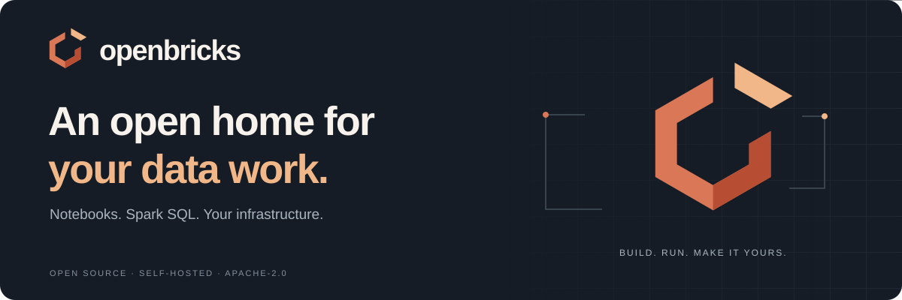

# OpenBricks brand kit

**An open home for your data work.**

OpenBricks is an open-source home for notebooks, Spark SQL, schedules, and reusable data code. The name connects building blocks with the freedom to run and extend the platform on your own infrastructure.

## The open brick

The original geometric mark is an open hexagonal brick with one top piece lifting away. The opening suggests access and extension; the separate piece suggests a module you can move, reuse, or build on. It replaces the earlier generic stacked-layer symbol.



## Choose an asset

| Asset | Use |
| --- | --- |
| Full-color mark: [SVG](assets/openbricks-mark.svg) · [PNG](assets/openbricks-mark.png) | Avatars, icons, and small placements; transparent background |
| Monochrome mark: [SVG](assets/openbricks-mark-mono.svg) · [PNG](assets/openbricks-mark-mono.png) | Single-color printing and restrained UI treatments |
| Wordmark for light backgrounds: [SVG](assets/openbricks-logo-light.svg) · [PNG](assets/openbricks-logo-light.png) | Dark lettering on a transparent background |
| Wordmark for dark backgrounds: [SVG](assets/openbricks-logo-dark.svg) · [PNG](assets/openbricks-logo-dark.png) | Light lettering on a transparent background |
| README banner: [SVG](assets/openbricks-banner.svg) · [PNG](assets/openbricks-banner.png) | 1200 × 400 GitHub/documentation header |
| [Social card](assets/openbricks-social.png) | 1200 × 630 repository social-preview image |

Matching PNG exports accompany the SVG files. SVG is the editable, scalable source; PNG is convenient for services that require a raster image. The mark PNG is 1024 × 1024 with transparency. The app favicon uses the same geometry on an ink background.

## Palette and typography

| Color | Hex | Role |
| --- | --- | --- |
| Clay | `#D97757` | Primary mark |
| Ember | `#B74E33` | Lower-right facet |
| Oat | `#F1B788` | Lifted piece and highlights |
| Ink | `#161C25` | Dark backgrounds and wordmark text |
| Paper | `#F7F3EC` | Light text and neutral surfaces |

The display wordmark is lowercase **openbricks**. Use **OpenBricks** in prose, headings, package descriptions, and project references. The supplied SVG lockups use a system sans-serif stack; no proprietary or downloaded font is required.

Allow clear space of at least one lifted-piece height around the mark. Use the simple mark at small sizes and test contrast on the actual background. Preserve its proportions, opening, and separate top piece. Avoid stretching, rotating, adding outlines, replacing the opening with a solid block, or recreating the old stacked-layer mark.

## Regenerate the kit

The geometry lives in [scripts/generate-brand.mjs](../scripts/generate-brand.mjs). Run it from the project root:

```bash
node scripts/generate-brand.mjs
```

It writes the SVG kit, `web/app/icon.svg`, and `web/lib/brand.ts`, which the app's `BrickMark` component uses. After installing web dependencies, export PNGs too:

```bash
node scripts/generate-brand.mjs --png
```

Keep all generated assets together when changing the mark. Check a small icon, light and dark wordmarks, the banner, and the actual UI before committing.

## Attribution and independence

The original OpenBricks assets are distributed with the project under [Apache-2.0](../LICENSE). Use the name and logo accurately and identify unofficial forks or services as such.

OpenBricks is independent of Databricks. Databricks, Apache Spark, Unity Catalog, Microsoft SQL Server, and other referenced products retain their own names, marks, and licenses. The OpenBricks identity should not imply affiliation or endorsement.
